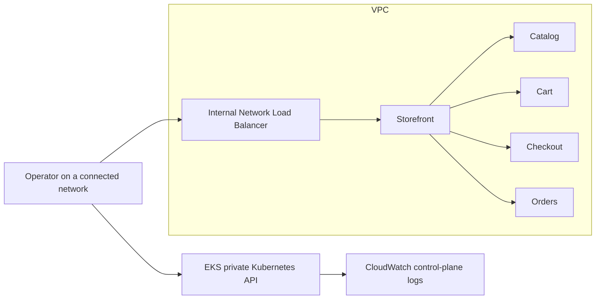

# Retail EKS Platform

A five-service retail demo and AWS DevOps portfolio project based on the AWS Containers Retail Sample. The portfolio work focuses on operating the workload on EKS, restricting network exposure, and verifying changes before deployment.

| Service | Role |
| --- | --- |
| UI | Java storefront and browser entry point |
| Catalog | Go product catalog API |
| Cart | Java shopping cart API |
| Checkout | Node.js checkout coordination |
| Orders | Java order processing |



## Quick demo

Run the upstream standalone image to explore the storefront without AWS infrastructure.

```sh
docker run --rm -p 127.0.0.1:8888:8080 public.ecr.aws/aws-containers/retail-store-sample-ui:1.0.0
```

Open [localhost:8888](http://localhost:8888). See the [developer guide](DEVELOPER_GUIDE.md) to build and test the services from source. The upstream image shows the upstream storefront branding.

## Deploy to AWS

1. Choose the [minimal EKS profile](terraform/eks/minimal/README.md) for the cluster and VPC, or the [default EKS profile](terraform/eks/default/README.md) for managed application dependencies and Helm deployments.
2. Use a Terraform runner that can reach the private API endpoint, or configure `cluster_public_access_cidrs` with approved operator egress CIDRs. Private access remains enabled in both modes. See the [AWS EKS endpoint guide](https://docs.aws.amazon.com/eks/latest/userguide/config-cluster-endpoint.html).
3. Review the Terraform plan for your account and region before applying. Keep state in an access-controlled encrypted backend because it can contain database credentials. EKS, NAT, load balancers, and managed dependencies incur charges.
4. Configure kubectl using `terraform output -raw configure_kubectl`. Check node readiness with `kubectl get nodes`. For the default profile without Istio, check `kubectl -n ui rollout status deployment/ui --timeout=180s` and `kubectl -n ui get svc ui`. Reach the internal load balancer over a network connected to the VPC or use `kubectl -n ui port-forward svc/ui 8080:80`.
5. Use the [operations runbook](docs/eks-operations.md) for verification and cleanup.

## Delivery and security

- Pull-request checks build and test affected components. Existing end-to-end workflows exercise Compose and Kubernetes.
- The EKS workflow initializes and validates both Terraform profiles and scans the repository for vulnerabilities and secrets. It uses read-only repository permissions and runs without AWS credentials.
- Both EKS profiles start with a private API and publish all five EKS control-plane log categories to CloudWatch with 30 days of retention. The default storefront and optional Istio gateway use internal load balancers.
- The inherited ECS and App Runner examples are retained for reference. The changes described here apply to EKS.

## Attribution

Based on the [AWS Containers Retail Sample](https://github.com/aws-containers/retail-store-sample-app). See the [upstream license](LICENSE). Portfolio changes include the EKS endpoint policy, internal ingress, control-plane logging, CI, and operational documentation.
