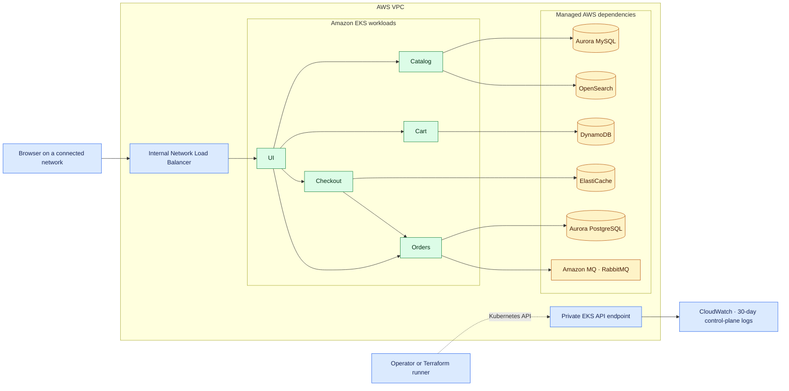
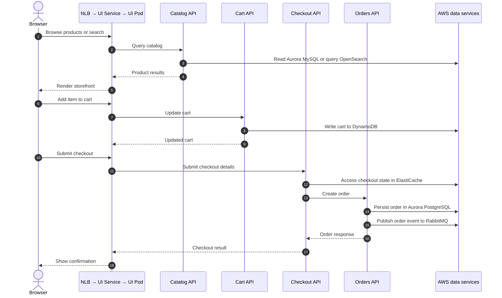
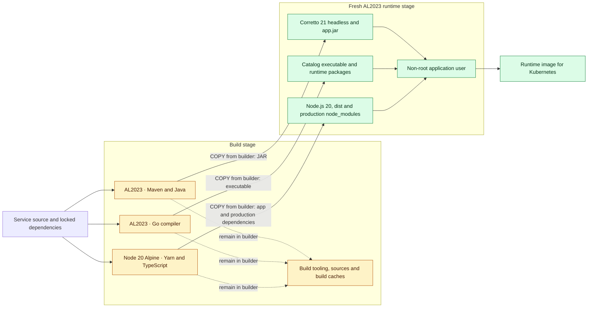
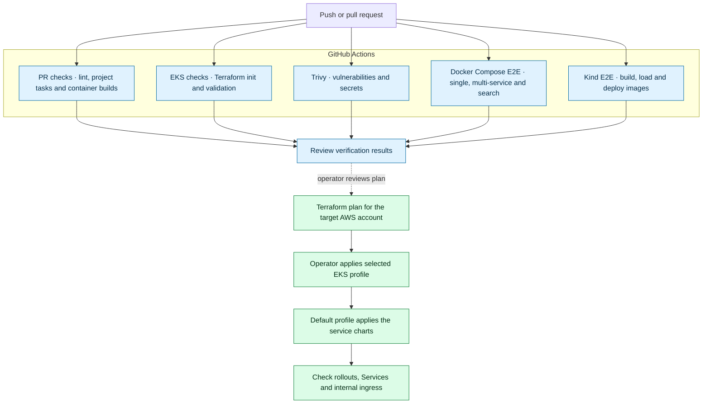
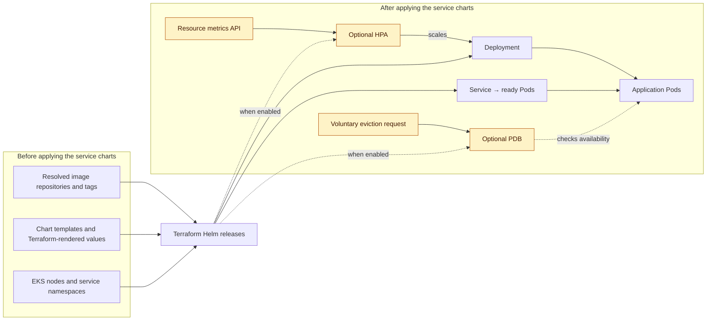

# Retail EKS Platform

**A five-service storefront on Amazon EKS, with private ingress, managed AWS data services, and container builds that leave the build toolchain behind.**

[](https://github.com/Pradyut6/retail-eks-platform-app/actions/workflows/eks-checks.yml)
[](https://github.com/Pradyut6/retail-eks-platform-app/actions/workflows/e2e-test.yml)

[Architecture](#aws-architecture) · [Traffic](#microservice-traffic) · [Image builds](#multi-stage-al2023-images) · [CI](#verification-and-deployment-workflow) · [Helm and availability](#before-and-after-helm)

## AWS architecture

The default EKS profile runs each service in its own namespace and connects the application to managed AWS dependencies. In the default non-Istio path, an **internal Network Load Balancer** forwards storefront traffic to UI Pods. Operators reach the Kubernetes API through a separate private endpoint path.



| Service | Runtime | Responsibility | Default EKS dependency |
| --- | --- | --- | --- |
| **UI** · `ui` | Java 21 | Storefront and server-side API calls | Catalog, Cart, Checkout, and Orders |
| **Catalog** · `catalog` | Go | Product details and search | Aurora MySQL and OpenSearch |
| **Cart** · `carts` | Java 21 | Cart reads and writes | DynamoDB via IAM role for service accounts |
| **Checkout** · `checkout` | Node.js 20 | Checkout state and order submission | ElastiCache and Orders API |
| **Orders** · `orders` | Java 21 | Order writes, reads, and messaging | Aurora PostgreSQL and Amazon MQ for RabbitMQ |

[Terraform Helm wiring](terraform/eks/default/kubernetes.tf) · [Managed service definitions](terraform/lib/dependencies)

## Microservice traffic

The browser talks to the storefront. The storefront calls the backend Services over cluster DNS, and Checkout calls Orders when an order is submitted.



The diagram shows the application call path. [Storefront service endpoints](terraform/eks/default/values/ui.yaml) · [Checkout order submission](src/checkout/src/checkout/checkout.service.ts)

## Multi-stage AL2023 images

Each application Dockerfile builds an artifact in one stage and copies only the runtime deliverables into a fresh Amazon Linux 2023 stage. UI, Cart, Orders, and Catalog use AL2023 builders. Checkout uses Node 20 Alpine to build TypeScript and prune development dependencies, then runs on AL2023 with Node.js 20.



| Image family | Builder does | Final image receives |
| --- | --- | --- |
| [UI](src/ui/Dockerfile), [Cart](src/cart/Dockerfile), [Orders](src/orders/Dockerfile) | Resolves Maven dependencies and packages the application | Application JAR and Corretto headless runtime |
| [Catalog](src/catalog/Dockerfile) | Resolves Go modules and compiles the server | Compiled server and runtime packages |
| [Checkout](src/checkout/Dockerfile) | Builds TypeScript and prunes development dependencies | Compiled JavaScript, production dependencies, and Node.js |

The runtimes apply AL2023 package updates, skip weak package dependencies, and run the application as a non-root user. [AL2023 release updates](https://docs.aws.amazon.com/linux/al2023/ug/deterministic-upgrades-usage.html)

## Verification and deployment workflow



GitHub Actions verifies the repository without AWS deployment credentials. An operator separately reviews and applies the AWS Terraform plan. The **minimal** profile provisions the cluster and network. The **default** profile also provisions the application dependencies and installs the Helm releases. The UI release depends on the four backend releases.

[PR workflow](.github/workflows/pr.yaml) · [EKS and security workflow](.github/workflows/eks-checks.yml) · [E2E workflow](.github/workflows/e2e-test.yml)

## Before and after Helm



**HPA and PDB resources are opt-in.** The standard Terraform-supplied values leave both disabled. With HPA enabled, a working resource metrics API and CPU requests let Kubernetes adjust Deployment replicas. With PDB enabled, Kubernetes checks availability before allowing voluntary evictions such as node drains. A PDB cannot prevent an involuntary outage.

For a chart-level preview of an HA configuration, create this values file and render the UI chart from the repository root. When Terraform owns a release, incorporate approved changes in its Helm values to keep the deployment reproducible.

```yaml
# availability.yaml
autoscaling:
  enabled: true
  minReplicas: 2
  maxReplicas: 5
  targetCPUUtilizationPercentage: 60
podDisruptionBudget:
  enabled: true
  minAvailable: 1
  maxUnavailable: null
```

```sh
helm template ui src/ui/chart --namespace ui -f availability.yaml
```

Use one disruption budget field. Here, `null` removes the chart’s default `maxUnavailable` value so that only `minAvailable` is emitted. [UI HPA template](src/ui/chart/templates/hpa.yaml) · [UI PDB template](src/ui/chart/templates/pdb.yaml)

## Run and verify

**Local preview.** The standalone upstream image starts the sample storefront without provisioning AWS infrastructure.

```sh
docker run --rm -p 127.0.0.1:8888:8080 public.ecr.aws/aws-containers/retail-store-sample-ui:1.0.0
```

Open [localhost:8888](http://localhost:8888). Use the [developer guide](DEVELOPER_GUIDE.md) for source builds and multi-service testing.

**EKS.** Start with the [minimal](terraform/eks/minimal/README.md) or [default](terraform/eks/default/README.md) profile. Run Terraform from a network that can reach the private EKS API. Review the plan and keep state in an access-controlled, encrypted backend. The default stack creates billable infrastructure.

After deploying the default profile without Istio, configure kubectl with the profile’s `configure_kubectl` output, then verify the storefront:

```sh
kubectl get nodes
kubectl -n ui rollout status deployment/ui --timeout=180s
kubectl -n ui get svc ui
kubectl -n ui get endpointslices -l kubernetes.io/service-name=ui
kubectl -n ui port-forward svc/ui 8080:80
```

| Signal | Start here |
| --- | --- |
| Terraform or kubectl cannot reach the API | Check private DNS and routing from the runner or operator network. |
| Internal NLB is pending | Check UI Service events and AWS Load Balancer Controller logs. |
| Storefront loads but an action fails | Check the UI logs, the affected backend, and its managed dependency. |
| HPA reports unknown CPU | Check the resource metrics API and container CPU requests. |
| A node drain stalls | Review the PDB’s allowed disruptions and ready replica count. |

Both EKS profiles export all five control-plane log categories to CloudWatch with 30 days of retention. For endpoint access, rollout verification, and teardown, use the [EKS operations runbook](docs/eks-operations.md).

## Attribution

Based on the [AWS Containers Retail Sample](https://github.com/aws-containers/retail-store-sample-app). The source and demo assets retain their original attribution under the [repository license](LICENSE).
